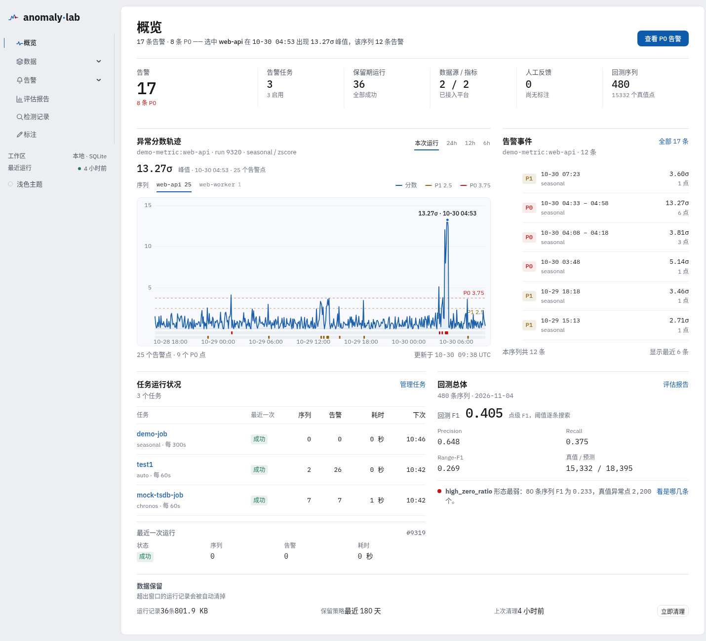
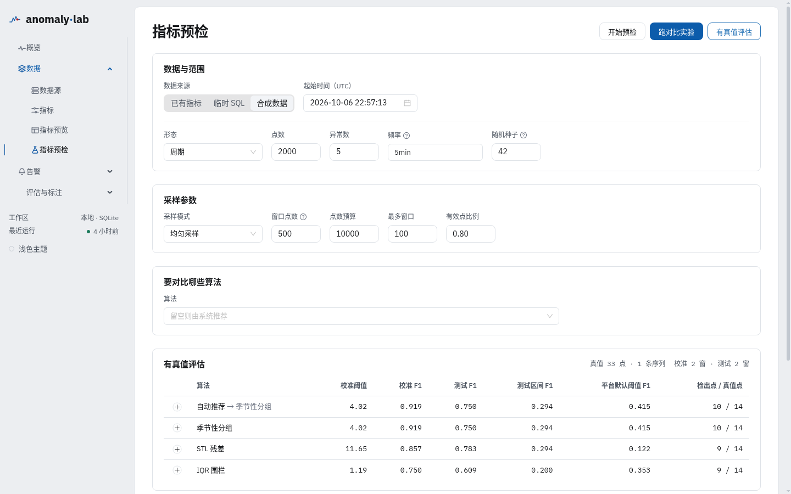
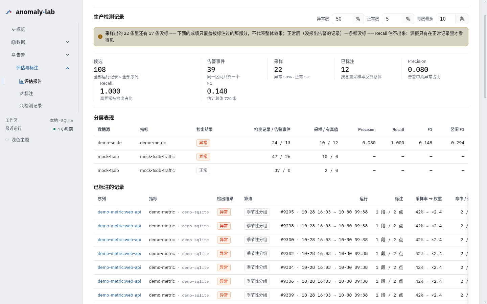
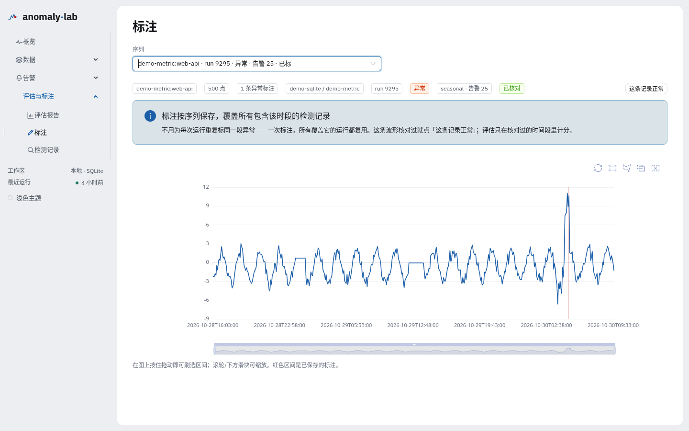
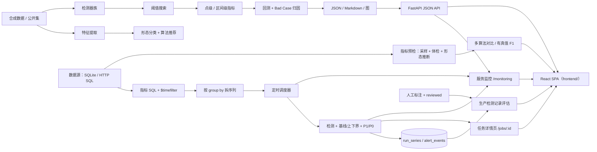

# anomaly-lab

[](https://www.python.org/)
[](https://nodejs.org/)
[](LICENSE)
[]()

一个端到端的时序异常检测实验室：**合成数据 → 形态分类 → 算法推荐 → 多类检测器 → 离线评测 → 回归报告 → Web 演示**，外加一条**平台切片**：SQLite / HTTP 数据源 → SQL 指标 → 定时拉取 → 基线/上下界 → P1/P0 分级 → 前端预览。

在此之上补了三层：

- **指标预检实验台**（`/lab`）—— 建告警任务**之前**先验证「这个指标到底能不能上检测」；
- **生产检测记录评估**（`/evaluation`）—— 线上跑的那次结果 × 人工标注，回答「上线之后到底准不准」；
- **服务监控**（`/monitoring`）—— 平台自身的 HTTP / 任务 / 算法 / 调度器指标，OpenTelemetry 埋点，
  可选导出到任意 OTLP 后端。

目标是完整走通工程闭环，并把每一步的取舍和数据都留下来。

> 结论先行：在自建合成集上，分类器 120/120 全对；检测器里 Theil-Sen 稳健趋势线总体 F1 最高（0.515），去趋势 IQR 紧随（0.510），LSTM 0.458，TCN（0.279）仍未跑赢简单基线。这些数字只代表合成分布，不代表真实业务效果。

## 界面

| 概览：告警、分数轨迹与回测总体 | 指标预检：有真值评估（校准 / 测试分离） |
|---|---|
|  |  |

| 生产检测记录：分层采样与反算 | 标注：一条波形「核对过 / 有异常」 |
|---|---|
|  |  |

## 服务监控

`/monitoring` 是平台**自己**的可观测性页面 —— 回答「这个服务现在怎么样」，
和「业务数据有没有异常」分开。

| 层 | 看什么 |
|---|---|
| HTTP | 每分钟请求数、P50 / P95 / P99、5xx 数、进行中请求。标签用**路由模板**，不按真实 URL 爆基数 |
| 任务 | 每次运行的总耗时与阶段耗时（取数 / 检测 / 落盘）、成功 / 失败 / 数据不足 |
| 算法 | 每个算法被调用多少次、平均与 P95 耗时、回退次数、异常次数 |
| 调度器 + 进程 | tick 频率与耗时、到期任务数、线程是否停滞、CPU / 内存 / DB 与 run 目录占用 |

埋点只调用 **OpenTelemetry** API：`MeterProvider` 挂两个 reader ——
一个把指标写本地 SQLite（`data/metrics.db`），另一个在配置了端点时按 OTLP 发出去。
同一份埋点，两个消费者，不会各埋一套。

- **本地历史默认就有**：`metrics.db` 保留 30 天，重启不丢，页面直接查库；
- **默认不导出**：不配 `ANOMALY_OTEL_ENDPOINT` 时，OTLP 那一路不启用；
- **要接 Grafana / Jaeger / 任意 OTLP 后端**：

  ```bash
  pip install -e '.[otel]'
  ANOMALY_OTEL_ENDPOINT=http://localhost:4318 make serve
  ```

  指标发到 `/v1/metrics`，链路发到 `/v1/traces`（Collector 默认的 HTTP 端口）；
- 导出间隔 `ANOMALY_MONITOR_INTERVAL`（秒，默认 15），保留天数
  `ANOMALY_MONITOR_RETENTION_DAYS`（默认 30）。

⚠️ 时间线是**分钟粒度**：`metric_samples` 每分钟一行，`metric_totals` 只保留最新的
全维度累计（按路由 / 算法 / 任务），所以 30 天也就几十 MB。

## 架构



详见 [docs/ARCHITECTURE.md](docs/ARCHITECTURE.md)、[docs/ALGORITHMS.md](docs/ALGORITHMS.md)、[docs/DATA.md](docs/DATA.md)、[docs/PLATFORM.md](docs/PLATFORM.md)、[docs/LAB.md](docs/LAB.md)。

### 分层与契约

五层单向依赖，层间只走两个数据契约（`src/anomaly_lab/contracts.py`）：

```
L1 数据 → L2 形态分类 → L3 检测器 → L4 评估闭环 → L5 CLI / Web
```

| 契约 | 作用 |
|---|---|
| `SeriesBundle` | 一条时序 + 标注来源 + 元信息（L1 出，全程携带） |
| `DetectionResult` | 分数 + `score_type` + 阈值 + **基线三件套** + `band_kind` |

检测器的输出**必须**显式声明分数语义（`score_type`）与带的语义（`band_kind`）——
这是评估层能按语义分桶搜阈值、前端能正确标注的前提。详见
[docs/DESIGN.md §13](docs/DESIGN.md#13-原始设想与落实对照)（原始设想 → 落实逐条对照）。

## 5 分钟快速开始

```bash
git clone <repo-url> anomaly-lab
cd anomaly-lab

# 依赖由 requirements.lock 锁定（国内网络默认走清华镜像，见 Makefile 的 PIP_INDEX）
make setup

# 深度模型需要 CPU 版 torch（可选；不装则自动跳过 TCN/LSTM）
uv pip install torch --index-url https://download.pytorch.org/whl/cpu

# 前端依赖（React 工程，首次或 package-lock.json 变更后执行）
make frontend-install

make generate     # 生成 120 条合成序列
make evaluate     # 用 IQR 检测并产出 reports/latest/report.md
make compare      # 统计 + 自训深度 + Chronos（不可用则跳过）对照表
make serve        # 构建前端并起服务：http://127.0.0.1:8000
```

起来之后建议按这个顺序看：

| 页面 | 看什么 |
|---|---|
| `/` | 平台在跑：告警事件、分数轨迹、回测总体 |
| `/lab` | 选「合成数据」→ 点「有真值评估」，看 校准 F1 / 测试 F1 分离 |
| `/evaluation` | 顶部「生产检测记录」：分层采样、反算权重、核对覆盖率 |
| `/annotate` | 选一条生产检测记录 → 看波形 → 点「这条记录正常」 |

开发时前后端分开跑（vite 热更新 + `/api` 代理到 8000）：

```bash
make dev          # vite :5173 + uvicorn :8000
```

平台切片（定时检测）：

```bash
make platform-demo   # 生成 demo 的 SQLite 源库 + 指标 + 任务
make serve           # 打开 http://127.0.0.1:8000/jobs 配置与预览
```

带「远端」的完整演示 —— 假远端时序数据库（照 InfluxDB 3 的 API 形状，持续造数）：

```bash
make mock-tsdb       # 假远端 → http://127.0.0.1:8181/api/v3/query_sql
make mock-demo       # 平台侧建好 HTTP 数据源 + 指标 + 检测任务
make serve           # 在「数据源 → mock-tsdb」里浏览数据、跑检测
# 或者一条命令全起（前端 + 后端 + 假远端）：
MOCK_TSDB=1 make dev
```

端到端冒烟：

```bash
./scripts/smoke.sh          # 离线全流程
./scripts/platform_smoke.sh # 平台链路：建配置 → 跑任务 → 有告警
# 或离线模式：ANOMALY_LAB_OFFLINE=1 ./scripts/smoke.sh
```

测试（CI 每次推送都跑，见 `.github/workflows/ci.yml`）：

```bash
.venv/bin/python -m pytest -p no:warnings   # 后端 939 passed
.venv/bin/python -m mypy                     # 类型检查（src/anomaly_lab）
cd frontend && npx tsc --noEmit              # 前端类型检查
cd frontend && npx vitest run                # 前端 478 passed / 57 files
```

⚠️ `torch` / `chronos` 是**可选依赖**：没装时相关用例自动跳过，
不会变成「克隆下来就红」。

依赖变了之后用 `make lock` 重新生成 `requirements.lock`。

## 指标预检实验台（`/lab`）

**问题**：现有链路是「数据源 → 指标 → 告警任务」，缺了「**这个指标到底能不能上检测**」。
`auto` 的形态推断要等任务跑完一次才发生，结果埋在产物里 —— 对新指标是倒序的。

| 能力 | 做什么 |
|---|---|
| P0 切片与体检 | 四种来源（已有指标 / 临时 SQL / 合成 / 公开集）、跨窗采样、质量体检、形态推断，并在选算法**之前**给出周期可识别性（`period_capability`） |
| P1 多算法实验 | 同一批窗口跑多个算法；检出画像、倍数敏感性、跨窗稳定性 |
| P2 实验记录 | spec + env + result 落盘；指纹剔除 `elapsed_ms`，同 spec 两次结果一致；「一键建任务」把结论回填表单 |
| P3 有真值 | 合成 / 公开集 / 人工标注 → P·R·F1 |

两条硬约定：

- **校准与测试按窗口时间顺序切**，绝不跨界 —— 跨界就是真值泄漏。校准集**逐窗搜阈值再取中位数**，判定用 `scores >= threshold`；
- **产物隔离**在 `data/lab/experiments/`，永不写入 `reports/latest/`。

验收：合成场景下 lab 的算法排名与离线评测一致，且 lab F1 不高于离线（`tests/lab/test_evaluate.py`）。

> 无真值是主场景，产出是「证据 + 取舍」，不是 F1 —— 不假装有真值。

## 生产检测记录评估

**口径**：评估**线上跑的那次结果**（run 产物里的 `scores` / `severity`）× **人工标注过的记录**，
**不重跑**。重跑得到的是「现在的算法在旧数据上」的成绩，不是线上真实效果。

### 分层采样

```
数据源 → 指标 → 检出结果（异常 / 正常）
```

异常层与正常层**各自采样率**（默认 50% / 5%，另有每层上限）——
正常记录远多于异常记录，同一个采样率要么标不完、要么异常样本太少。
正常层是估**漏报**的唯一来源。

### 「核对过」是一等标注

| 类型 | 内容 | 作用 |
|---|---|---|
| 异常区间 | `type=spike/drift/…` + `start`/`end` | 真值 |
| `reviewed` | 只有 `run_id`，**没有边界** | 负样本标签 + 覆盖率声明 |

⚠️ **没有负样本标签，就没有分母**：一条 6 分钟的标注会让同一窗口里其余 23 个告警点
**凭空变成误报**。所以评估只在核对过的时间段里计分；老标注没有 `reviewed` 记录时，
退化成「只在标注区间内计分」（保守口径，不凭空产生误报）。

### 反算

每条标注带上它所在层的采样率，总体混淆矩阵 = Σ(1/rate)·单条计数。
**比率不能平均**；区间级 F1 不能反算，只给加权平均并标为参考值。

### 系统会说自己不可信

只核对了一小段时，报告直接写出来：

> 这些记录里只有 24/6000 个点被核对过（0.4%）—— 数字只代表核对过的那部分

「25 个告警里 2 个真」和「25 个告警里 2 个被核对过」是两回事，界面不让人混。

## 数据

- **合成集（主力）**：6 种形态（平稳、周期、趋势、阶梯、高零值、稀疏事件）× 6 种异常（尖峰、上下文、漂移、频率突变、方差突变、平台断流），共 120 条、每条 500 点，随机种子可复现，真值逐点标注。
- **公开集（泛化验证）**：UCR 异常库按序列惰性加载，只读缓存，不拉全量 zip；离线时缺失缓存直接抛 `DatasetUnavailable`。公开集不参与调参。
- **人工标注**：`data/annotations/<series_id>.jsonl`，**按序列存**（不绑定 run —— 滚动窗口下同一个异常会被连续几十次运行报出）。每行两种形态之一：异常区间（`start`/`end` 是时间戳），或 `reviewed`（整条记录核对过）。格式见 [docs/DATA.md](docs/DATA.md)。

合成数据结论不等于真实分布结论，公开集仍需按场景校准。

## 算法

统一约定：**分数越大越异常**，且每个检测器显式声明 `score_type`（`zscore` / `pvalue` / `residual_ratio` / `prob`），阈值搜索按语义分桶，避免“把 p 值当 z 分数”的混用。

| 族 | 检测器 | 核心思想 |
|---|---|---|
| 统计 | IQR / MAD / ZScore | 稳健基线 + 绝对偏差标准化 |
| 统计 | Seasonal | 周期内同相位分组，组内中位数/MAD |
| 统计 | STLResidual | STL 分解后的残差 / 残差 MAD |
| 统计 | `theil_sen` | Theil-Sen 稳健趋势线（点对斜率中位数）+ 残差 MAD |
| 统计 | `trend_residual_iqr`（旧名 DeseasonalizedIQR） | 先线性去趋势，再跑 IQR |
| 统计 | ChangePoint | 滑窗双样本 t 检验，`1 - p` 为概率 |
| 统计 | EventCount | 窗口非零事件数 vs 泊松基线（**因果窗口**，告警只落在事件点） |
| 统计 | `poisson_count` | 计数值本身 vs 泊松期望（单点 + 窗口累计上尾，区分「1 次」和「10 次」） |
| 统计 | `zero_inflated_iqr` | 只用**非零子集**估 IQR —— 零值 >75% 时普通 IQR 的分母会归零 |
| 自训深度 | TCN / LSTM | 一维重构自编码器，重构误差归一为概率 |
| 预训练 | Chronos | 分位数预测区间的越界程度（权重不可用时跳过） |

### 尺度降级链：算不出来时不能假装「一切正常」

稳健检测器的分数是 `|x − center| / scale`。零膨胀数据上 `scale` 会变成 0，
除零得到 NaN —— 如果把它写成 0 分，界面就会显示「一切正常」，而实际上**什么都没算出来**。

所以所有尺度型检测器共用一条降级链：**IQR → MAD → std → 不可判**。
每一档都有明确的失效边界（零值 >75% 时 IQR=0；>50% 时 MAD 更早归零），
降级与「不可判」都会写进结果（`scale_source` / `scale_fallback` / `status`），
前端显示成「尺度降级」或「无法判定」，绝不静默。

### 基线三件套：分数之外，还要说「正常值在哪儿」

分数只说“多异常”，不说“正常值应该在哪儿”。所以 `DetectionResult` 除了分数，还带一组可选的
`expected`（基线）/ `lower` / `upper`（容忍带），三者同生同灭、长度等于序列长度。

**带的语义有两种，不能混**（`band_kind` 显式声明）：

| `band_kind` | 谁产出 | 含义 |
|---|---|---|
| `alert_boundary` | 统计型检测器 | 带边界**就是告警阈值** —— 值出带 ⟺ 判为异常 |
| `prediction_interval` | TCN / LSTM / Chronos | 带是**模型自己的预测/重构区间**，表达「模型认为正常值在哪儿、有多不确定」，**不是**告警边界 |

预测型检测器的分数是序列内 min-max 归一的相对量（不是「多少倍尺度」），所以它的带和它的告警阈值
本来就不是同一条边界 —— 前端会分别标注，不让人把置信区间误读成告警线。

⚠️ 前端画带**不用 `stack` + `areaStyle`**：stack 是累加的，且对负值行为不可预测（实测会画到
`[lower+upper]` 而不是 `[lower, upper]`）。改用 custom series 画多边形，行为确定。详见
`frontend/src/lib/bands.ts`。

## 评测结果（真实跑出，单次 CPU 测量）

120 条合成序列，逐条搜索阈值后按序列平均；`F1` 为点级，`Range-F1` 为区间级。

| 检测器 | Precision | Recall | F1 | Range-F1 | 单条延迟 |
|---|---:|---:|---:|---:|---:|
| TheilSen | 0.801 | 0.462 | **0.515** | 0.358 | 0.01 ms |
| TrendResidualIQR | 0.790 | 0.469 | 0.510 | 0.322 | 0.30 ms |
| Seasonal | 0.751 | 0.443 | 0.472 | 0.342 | 0.09 ms |
| Chronos | 0.676 | 0.426 | 0.468 | 0.311 | 340.13 ms |
| ZScore | 0.780 | 0.418 | 0.465 | 0.294 | 0.08 ms |
| IQR | 0.761 | 0.424 | 0.458 | 0.331 | 0.19 ms |
| MAD | 0.761 | 0.424 | 0.458 | 0.331 | 0.19 ms |
| LSTM | 0.738 | 0.418 | 0.458 | 0.294 | 0.01 ms |
| STLResidual | 0.474 | 0.521 | 0.339 | 0.237 | 0.08 ms |
| TCN | 0.365 | 0.391 | 0.279 | 0.188 | 0.01 ms |
| EventCount | 0.243 | 0.846 | 0.252 | 0.267 | 0.32 ms |
| ChangePoint | 0.165 | 0.665 | 0.207 | 0.247 | 132.15 ms |

复现：`make evaluate-all`（= `python scripts/evaluate_all.py`，12 个检测器 × 120 条序列 = 1440 行，
逐条搜索阈值后按序列平均）。`make evaluate` 只聚合 `make detect` 产出的统计型检测器，
深度模型与 Chronos 需要先训练 / 有本地权重，所以走前者。

形态分类：**100.00%（120/120）**；冒烟集 6/6。完整逐形态对照见 `reports/compare.md`。

> 与上一版（2026-11-04）的差异主要在 IQR / MAD：0.310 / 0.283 → 0.458 / 0.458。
> 原因是尺度降级链 —— 零膨胀数据上 IQR/MAD 的分母归零，旧实现把算不出来的分兜底成 0
> （一条都不报），现在退到 std 兜底，稀疏序列才真正参与评测。这是修正，不是评测口径变化。

## 一次真实迭代：把固定周期换成检测出的周期

- **问题**：`SeasonalDetector` 在 CLI 里固定 `period=24`，周期型序列的总体 F1 一直偏低。
- **归因**：合成周期型数据的真实周期在 24 和 48 之间变化；固定 24 会让部分序列相位分组错位，残差被抬高，阈值搜索也救不回来。
- **最小改动**：`fit` 时调用 `extract_features(...).dominant_period`，拿不到再回退 24；其余逻辑不动。
- **回归对比**（同一份 120 条数据，逐条搜索阈值）：

| 指标 | 固定 24 | 自适应周期 | 变化 |
|---|---:|---:|---:|
| 总体 F1 | 0.423 | 0.436 | +0.013 |
| 周期型 F1 | 0.588 | 0.667 | +0.079 |
| Range-F1 | 0.325 | 0.336 | +0.012 |

复现实验（报告写到临时目录后用 `diff_reports` 对比）：

```python
from anomaly_lab.data.loader import load_dataset
from anomaly_lab.detectors.statistical import SeasonalDetector
from anomaly_lab.evaluation.backtest import backtest_detector
from anomaly_lab.evaluation.report import build_report, diff_reports

series = load_dataset("data/synthetic")
before = backtest_detector(series, lambda: SeasonalDetector(period=24))
after = backtest_detector(series, lambda: SeasonalDetector())
build_report(before, "reports/iteration/before", "fixed 24")
build_report(after, "reports/iteration/after", "auto")
print(diff_reports("reports/iteration/before/report.json",
                   "reports/iteration/after/report.json"))
```

## 平台切片（定时检测）

一条可运行的链路：**数据源 → 指标 SQL（`$timefilter`）→ 按 group by 拆序列 → 定时拉取 → 基线与双向上下界 → P1/P0 分级 → 前端预览**。

- 配置分三层：数据源 → 指标 → 检测任务，都存在 `data/platform.db`。
- 数据源支持 SQLite 文件与 **HTTP SQL 透传**（InfluxDB 3 / ClickHouse / TDengine 的 SQL-over-HTTP 网关）；连接器只负责「SQL → DataFrame」，时间解析 / 排序 / group by / 缺失值策略全部共用。
- 任务自己配告警规则：一张「条件 → 等级」表，如 `2.5, P1` / `3.75, P0`（倍数条件），也可混写 `>50, P0`（绝对值条件，只抬不压）。顺序即档位顺序（最后一行最严重），命中多条取最高档；「10 突增到 50 算 P0 还是 P1」没有通用答案，所以交给用户配置。
- 调度器内置在 `serve` 里，重启后错过的窗口只补跑一次；`--no-scheduler` 可关闭。
- **检测记录落库**：`run_series`（序列摘要 + 时间范围 + `content_hash`）与 `alert_events`（告警区间）；逐点数组仍留 npz。查询不再扫产物目录（实测 8700 多个目录 → 一条 SQL）。
- **告警方向**：任务可配「双向 / 只报偏高 / 只报偏低」。方向按「值相对检测器基线」判断，过滤发生在告警层（`severity`）——生产评估用的也是它，所以两侧口径一致。没有基线的计数型算法只能报偏高，界面会禁用「只报偏低」并说明原因。
- **告警记录**（`/alerts`）：跨任务汇总告警事件，一条事件是一段连续告警点合并成的区间；取各任务最近一次运行的结果，没纳入统计的任务会说明原因。
- **决策链**：每次运行都记录「数据质量 → 能力探测 → 形态判断 → 算法选择 → 阈值与分级 → 结果」六段，落在 `run_series.decision_json` 并在检测记录里展开；异常路径（算法回退、尺度降级、能力不足）高亮。
- **检测记录**（`/detections`）分两个页签：「平台运行」是**每次运行 × 每条序列**（包括「跑了但没告警」的记录，`GET /api/platform/detections`），点任意一行看波形与六段决策链；「离线评测集」是 `reports/latest` 的逐条回测记录（有真值，能算 P/R/F1）。两者口径不同，不混在一张表里。
- **能力探测**：建任务/试跑时就指出「这份数据会让哪些算法失效」—— 零膨胀、非零点太少、计数型被 zscore 标准化；以及形态前提不成立（没有可信周期 → `seasonal` 退化、`stl_residual` 估出伪周期；去趋势后残差仍有结构 → 趋势类算法拟合不完整）。只提示与当前算法相关的那条，且形态类问题不改变「数据质量」结论。
- **删除**：任务 / 指标 / 数据源支持级联删除，run 目录文件一并清理；运行中的任务删不掉（返回 409）。
- **保留策略**：默认 180 天，最新一次运行永远保留、正在执行的不删；`anomaly-lab prune --dry-run` 先看会删什么。

细节与限制见 [docs/PLATFORM.md](docs/PLATFORM.md)。

## 项目边界

- 不接实时流、不做在线学习、不做告警编排；只做离线可复现的检测与评测。**重复告警是配置的函数**（检测窗口 / 运行间隔），去重与抑制归告警系统，不归评估。
- 合成集的 100% 分类准确率不代表真实指标；真实场景需要重新标注、校准阈值。
- 公开集只做泛化验证，UCR 单序列 URL 尚未校准，默认离线缓存模式。
- 生产评估的抽样假设标注覆盖与检出结果**无关**（MAR）。真实场景用户更愿意标异常，这个假设会偏 —— 时间分层是无偏估计的下一步。
- 平台切片目前无认证、单进程调度，不适合直接对外提供服务。
- 不使用任何现职公司的内部数据、代码、文档或系统命名；`compliance-check` 会扫描仓库。

## License

MIT，见 [LICENSE](LICENSE)。
