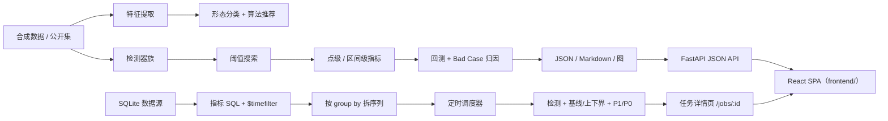

# anomaly-lab

[](https://www.python.org/)
[](LICENSE)
[]()

一个端到端的时序异常检测实验室：**合成数据 → 形态分类 → 算法推荐 → 多类检测器 → 离线评测 → 回归报告 → Web 演示**，外加一条**平台切片**：SQLite 数据源 → SQL 指标 → 定时拉取 → 基线/上下界 → P1/P0 分级 → 前端预览。目标是完整走通工程闭环，并把每一步的取舍和数据都留下来。

> 结论先行：在自建合成集上，分类器 120/120 全对；检测器里去趋势 IQR 的总体 F1 最高（0.510），LSTM 次之（0.458），TCN 未跑赢简单基线（0.279）。这些数字只代表合成分布，不代表真实业务效果。

## 架构



详见 [docs/ARCHITECTURE.md](docs/ARCHITECTURE.md)、[docs/ALGORITHMS.md](docs/ALGORITHMS.md)、[docs/DATA.md](docs/DATA.md)、[docs/PLATFORM.md](docs/PLATFORM.md)。

### 分层与契约

五层单向依赖，层间只走两个数据契约（`src/anomaly_lab/contracts.py`）：

```
L1 数据 → L2 形态分类 → L3 检测器 → L4 评估闭环 → L5 CLI / Web
```

| 契约 | 作用 |
|---|---|
| `SeriesBundle` | 一条时序 + 标注来源 + 元信息（L1 出，全程携带） |
| `DetectionResult` | 分数 + `score_type` + 阈值 + **基线三件套** + `band_kind` |

检测器的输出**必须**显式声明分数语义（`score_type`）与带的语义（`band_kind`）——
这是评估层能按语义分桶搜阈值、前端能正确标注的前提。详见
[docs/DESIGN.md §13](docs/DESIGN.md#13-原始设想与落实对照)（原始设想 → 落实逐条对照）。

## 5 分钟快速开始

```bash
git clone <repo-url> anomaly-lab
cd anomaly-lab

# 依赖（国内网络默认走清华镜像，见 Makefile 的 PIP_INDEX）
make setup

# 深度模型需要 CPU 版 torch（可选；不装则自动跳过 TCN/LSTM）
uv pip install torch --index-url https://download.pytorch.org/whl/cpu

# 前端依赖（React 工程，首次或 package-lock.json 变更后执行）
make frontend-install

make generate     # 生成 120 条合成序列
make evaluate     # 用 IQR 检测并产出 reports/latest/report.md
make compare      # 统计 + 自训深度 + Chronos（不可用则跳过）对照表
make serve        # 构建前端并起服务：http://127.0.0.1:8000
```

开发时前后端分开跑（vite 热更新 + `/api` 代理到 8000）：

```bash
make dev          # vite :5173 + uvicorn :8000
```

平台切片（定时检测）：

```bash
make platform-demo   # 生成 demo 的 SQLite 源库 + 指标 + 任务
make serve           # 打开 http://127.0.0.1:8000/jobs 配置与预览
```

带「远端」的完整演示 —— 假远端时序数据库（照 InfluxDB 3 的 API 形状，持续造数）：

```bash
make mock-tsdb       # 假远端 → http://127.0.0.1:8181/api/v3/query_sql
make mock-demo       # 平台侧建好 HTTP 数据源 + 指标 + 检测任务
make serve           # 在「数据源 → mock-tsdb」里浏览数据、跑检测
# 或者一条命令全起（前端 + 后端 + 假远端）：
MOCK_TSDB=1 make dev
```

端到端冒烟：

```bash
./scripts/smoke.sh          # 离线全流程
./scripts/platform_smoke.sh # 平台链路：建配置 → 跑任务 → 有告警
# 或离线模式：ANOMALY_LAB_OFFLINE=1 ./scripts/smoke.sh
```

测试：

```bash
.venv/bin/python -m pytest -p no:warnings   # 后端 590 passed
cd frontend && npx vitest run                # 前端 292 passed / 35 files
```

## 数据

- **合成集（主力）**：6 种形态（平稳、周期、趋势、阶梯、高零值、稀疏事件）× 6 种异常（尖峰、上下文、漂移、频率突变、方差突变、平台断流），共 120 条、每条 500 点，随机种子可复现，真值逐点标注。
- **公开集（泛化验证）**：UCR 异常库按序列惰性加载，只读缓存，不拉全量 zip；离线时缺失缓存直接抛 `DatasetUnavailable`。公开集不参与调参。
- **人工标注**：Web 刷选后追加到 `data/annotations/{series_id}.jsonl`，每行一条记录（含 `created_at`）。

合成数据结论不等于真实分布结论，公开集仍需按场景校准。

## 算法

统一约定：**分数越大越异常**，且每个检测器显式声明 `score_type`（`zscore` / `pvalue` / `residual_ratio` / `prob`），阈值搜索按语义分桶，避免“把 p 值当 z 分数”的混用。

| 族 | 检测器 | 核心思想 |
|---|---|---|
| 统计 | IQR / MAD / ZScore | 稳健基线 + 绝对偏差标准化 |
| 统计 | Seasonal | 周期内同相位分组，组内中位数/MAD |
| 统计 | STLResidual | STL 分解后的残差 / 残差 MAD |
| 统计 | DeseasonalizedIQR | 先线性去趋势，再跑 IQR |
| 统计 | ChangePoint | 滑窗双样本 t 检验，`1 - p` 为概率 |
| 统计 | EventCount | 窗口非零事件数 vs 泊松基线 |
| 自训深度 | TCN / LSTM | 一维重构自编码器，重构误差归一为概率 |
| 预训练 | Chronos | 分位数预测区间的越界程度（权重不可用时跳过） |

### 基线三件套：分数之外，还要说「正常值在哪儿」

分数只说“多异常”，不说“正常值应该在哪儿”。所以 `DetectionResult` 除了分数，还带一组可选的
`expected`（基线）/ `lower` / `upper`（容忍带），三者同生同灭、长度等于序列长度。

**带的语义有两种，不能混**（`band_kind` 显式声明）：

| `band_kind` | 谁产出 | 含义 |
|---|---|---|
| `alert_boundary` | 统计型检测器 | 带边界**就是告警阈值** —— 值出带 ⟺ 判为异常 |
| `prediction_interval` | TCN / LSTM / Chronos | 带是**模型自己的预测/重构区间**，表达「模型认为正常值在哪儿、有多不确定」，**不是**告警边界 |

预测型检测器的分数是序列内 min-max 归一的相对量（不是「多少倍尺度」），所以它的带和它的告警阈值
本来就不是同一条边界 —— 前端会分别标注，不让人把置信区间误读成告警线。

⚠️ 前端画带**不用 `stack` + `areaStyle`**：stack 是累加的，且对负值行为不可预测（实测会画到
`[lower+upper]` 而不是 `[lower, upper]`）。改用 custom series 画多边形，行为确定。详见
`frontend/src/lib/bands.ts`。

## 评测结果（真实跑出，单次 CPU 测量）

120 条合成序列，逐条搜索阈值后按序列平均；`F1` 为点级，`Range-F1` 为区间级。

| 检测器 | Precision | Recall | F1 | Range-F1 | 单条延迟 |
|---|---:|---:|---:|---:|---:|
| DeseasonalizedIQR | 0.793 | 0.472 | **0.510** | 0.321 | 0.11 ms |
| STLResidual | 0.694 | 0.457 | 0.473 | 0.295 | 31.20 ms |
| ZScore | 0.780 | 0.418 | 0.465 | 0.294 | 0.02 ms |
| LSTM | 0.738 | 0.418 | 0.458 | 0.294 | 1.93 ms |
| Seasonal | 0.598 | 0.460 | 0.436 | 0.336 | 0.51 ms |
| IQR | 0.529 | 0.295 | 0.310 | 0.205 | 0.05 ms |
| MAD | 0.473 | 0.274 | 0.283 | 0.191 | 0.04 ms |
| TCN | 0.365 | 0.391 | 0.279 | 0.188 | 1.81 ms |
| ChangePoint | 0.165 | 0.665 | 0.207 | 0.247 | 129.61 ms |
| EventCount | 0.145 | 0.879 | 0.205 | 0.235 | 0.13 ms |
| Chronos | 0.429 | 0.290 | 0.259 | 0.184 | 2238.81 ms |

形态分类：**100.00%（120/120）**；冒烟集 6/6。完整逐形态对照见 `reports/compare.md`。

## 一次真实迭代：把固定周期换成检测出的周期

- **问题**：`SeasonalDetector` 在 CLI 里固定 `period=24`，周期型序列的总体 F1 一直偏低。
- **归因**：合成周期型数据的真实周期在 24 和 48 之间变化；固定 24 会让部分序列相位分组错位，残差被抬高，阈值搜索也救不回来。
- **最小改动**：`fit` 时调用 `extract_features(...).dominant_period`，拿不到再回退 24；其余逻辑不动。
- **回归对比**（同一份 120 条数据，逐条搜索阈值）：

| 指标 | 固定 24 | 自适应周期 | 变化 |
|---|---:|---:|---:|
| 总体 F1 | 0.423 | 0.436 | +0.013 |
| 周期型 F1 | 0.588 | 0.667 | +0.079 |
| Range-F1 | 0.325 | 0.336 | +0.012 |

复现实验（报告写到临时目录后用 `diff_reports` 对比）：

```python
from anomaly_lab.data.loader import load_dataset
from anomaly_lab.detectors.statistical import SeasonalDetector
from anomaly_lab.evaluation.backtest import backtest_detector
from anomaly_lab.evaluation.report import build_report, diff_reports

series = load_dataset("data/synthetic")
before = backtest_detector(series, lambda: SeasonalDetector(period=24))
after = backtest_detector(series, lambda: SeasonalDetector())
build_report(before, "reports/iteration/before", "fixed 24")
build_report(after, "reports/iteration/after", "auto")
print(diff_reports("reports/iteration/before/report.json",
                   "reports/iteration/after/report.json"))
```

## 平台切片（定时检测）

一条可运行的链路：**SQLite 数据源 → 指标 SQL（`$timefilter`）→ 按 group by 拆序列 → 定时拉取 → 基线与双向上下界 → P1/P0 分级 → 前端预览**。

- 配置分三层：数据源 → 指标 → 检测任务，都存在 `data/platform.db`。
- 任务自己配告警规则：一张「条件 → 等级」表，如 `2.5, P1` / `3.75, P0`（倍数条件），也可混写 `>50, P0`（绝对值条件，只抬不压）。顺序即档位顺序（最后一行最严重），命中多条取最高档；「10 突增到 50 算 P0 还是 P1」没有通用答案，所以交给用户配置。
- 调度器内置在 `serve` 里，重启后错过的窗口只补跑一次；`--no-scheduler` 可关闭。
- group by 在加载层就拆好，检测器永远只面对一条序列。
- **告警中心**（`/alerts`）：跨任务汇总告警事件，一条事件是一段连续告警点合并成的区间，可按任务/档位/时间筛选；取各任务最近一次运行的结果，没纳入统计的任务会说明原因。
- **删除**：任务 / 指标 / 数据源支持级联删除，run 目录文件一并清理；运行中的任务删不掉（返回 409）。

细节与限制见 [docs/PLATFORM.md](docs/PLATFORM.md)。

## 项目边界

- 不接实时流、不做在线学习、不做告警编排；只做离线可复现的检测与评测。
- 合成集的 100% 分类准确率不代表真实指标；真实场景需要重新标注、校准阈值。
- 公开集只做泛化验证，UCR 单序列 URL 尚未校准，默认离线缓存模式。
- Chronos 预训练模型已纳入本次对比（F1 0.259，第 9/11）—— 权重不可用时 `compare` 会显式记录跳过原因，不再静默。
  平台的任务也能选它，但它比统计检测器慢三个数量级（约 2.2 秒/序列 vs 0.06 毫秒），
  且分数量纲不同（[0,1] 的相对越界程度，不是「多少倍尺度」），详见 [docs/PLATFORM.md](docs/PLATFORM.md)。
- 平台切片目前只有 SQLite 数据源、进程内预处理、无认证，不适合直接对外提供服务。
- 不使用任何现职公司的内部数据、代码、文档或系统命名；`compliance-check` 会扫描仓库。

## License

MIT，见 [LICENSE](LICENSE)。
