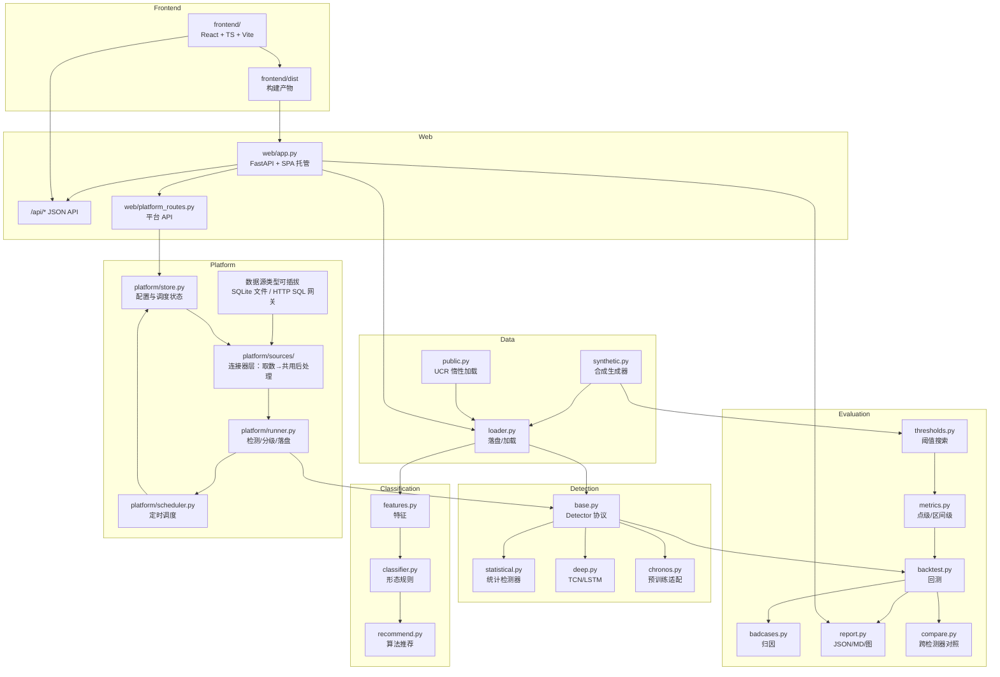
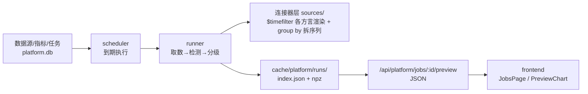
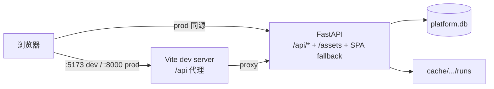

# 架构

## 分层

## 模块职责

| 模块 | 职责 |
|---|---|
| `contracts.py` | `SeriesBundle`（值/时间戳/标签/来源）与 `DetectionResult`（分数/阈值/是否异常） |
| `config.py` | 路径、随机种子；默认 `data/`、`reports/` |
| `data/` | 合成、落盘加载、公开集缓存与离线降级 |
| `classification/` | 特征、规则分类、推荐表 |
| `detectors/` | 统一协议 + 统计/深度/预训练实现 |
| `evaluation/` | 阈值、指标、回测、Bad Case、报告、对照 |
| `web/` | 只出 JSON API + 托管前端构建产物（SPA fallback）；不含任何页面模板 |
| `frontend/` | 独立前端工程：React 18 + TS + Vite + AntD v5 + TanStack Query + ECharts |
| `platform/` | 平台切片：元数据存储、连接器取数、任务执行、定时调度 |
| `mock_tsdb/` | **假远端**（演示用）：照 InfluxDB 3 的 API 形状，持续造数。独立进程，不参与平台逻辑 |

## 平台切片的数据流

- 配置与结果分离：SQLite 存配置、运行摘要与**检测记录**（序列摘要 + 告警区间），
  逐点数组落 npz，避免大对象进数据库。
- 检测记录落库让「有哪些检测记录」变成一条 SQL ——
  扫产物目录实测 8700 多个目录 = 0.47s，且随运行数线性涨。
- 取数与预处理第一版在进程内完成，边界是**连接器层**（`platform/sources/`）的
  `fetch` → `SeriesBundle` → 检测器，后续可把前者换成独立 worker。
- **连接器只负责「SQL → DataFrame」，后处理方言无关、全部共用**：时间解析、排序、
  group by 拆分、缺失值策略都在 `platform/sources/base.py` 里，只依赖 pandas，不依赖方言。
  换一种数据源 = 新增一个连接器类，不用复制后处理。
- **HTTP 透传是真的走网络**：`platform/sources/http_sql.py` 用标准库 `urllib.request`
  发请求，远端自己执行 SQL、只返回结果集。演示与验证靠 `mock_tsdb/`（独立进程，
  照 InfluxDB 3 的 API 形状）—— 跑在平台进程里的话连接、超时、502 都不成立。

## 关键契约

- 所有检测器必须实现 `fit → score → detect`，并声明合法 `score_type`；`validate_detector` 会拒绝未知语义。
- `score_type` 决定阈值搜索范围：`zscore`/`residual_ratio` 用 `[0, max]`，`pvalue`/`prob` 用 `[0, 1]`。
- 数据落盘格式：`index.json` + 每条序列一个 `.npz`，含 `values`、`timestamps`、`labels`、`meta`。
- 检测缓存：`data/cache/detections/<detector>/<series_id>.npz`。
- 报告：`reports/latest/report.json` 是唯一事实来源，Markdown 与图由它派生。

## Web 前端

前后端分离，但**单进程部署**：

- 前端是 `frontend/` 独立工程（React 18 + TS + Vite + AntD v5 + TanStack Query + ECharts）。
  后端只出 JSON API，不渲染任何页面。
- `frontend/dist` 由 `make frontend-build` 生成、**不入 git**；`create_app()` 向上找
  `frontend/dist`，也可通过 `create_app(frontend_dist=...)` 注入（测试用）。
- SPA fallback：所有非 `/api/*` 的未知路径回 `index.html`，深链接刷新不 404；
  拼错的 API 仍回 JSON 404；`dist` 缺失时回 503 并提示 `make frontend-build`。
- 开发：`make dev` 起 vite(:5173) + uvicorn(:8000) 两个进程；生产：`make serve` 先构建再起服务。
- 五态由 `StateBoundary` 统一处理：加载 / 空 / 错误 / **数据不足**（业务态）/ 正常。
  业务态靠后端 `X-Anomaly-Biz-State` 响应头识别（`no_run` / `no_series` / `no_data` /
  `insufficient_data` / `no_algorithms` / `no_result`），**绝不显示成红色错误框**。
- 视觉单一来源：`frontend/src/styles/tokens.css` 的 CSS 变量 → AntD token + ECharts 配色；
  双主题 `data-theme=dark|light`。ECharts 读不到 CSS 变量，需运行时读实际色值（`theme/cssVar.ts`）。

## 失败降级

- 公开集缺失 → `DatasetUnavailable`，不联网也能跑合成全流程。
- Chronos 不可用 → `ChronosUnavailable`，对照表记录跳过原因。
- torch 不可用 → 深度检测器导入失败时测试自动 skip，统计链路不受影响。
