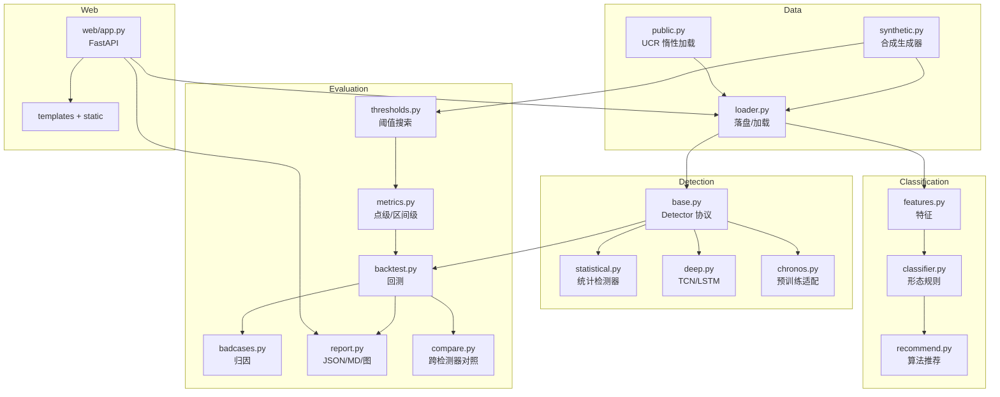

# 架构

## 分层

## 模块职责

| 模块 | 职责 |
|---|---|
| `contracts.py` | `SeriesBundle`（值/时间戳/标签/来源）与 `DetectionResult`（分数/阈值/是否异常） |
| `config.py` | 路径、随机种子；默认 `data/`、`reports/` |
| `data/` | 合成、落盘加载、公开集缓存与离线降级 |
| `classification/` | 特征、规则分类、推荐表 |
| `detectors/` | 统一协议 + 统计/深度/预训练实现 |
| `evaluation/` | 阈值、指标、回测、Bad Case、报告、对照 |
| `web/` | 标注页、评估页、序列 API |

## 关键契约

- 所有检测器必须实现 `fit → score → detect`，并声明合法 `score_type`；`validate_detector` 会拒绝未知语义。
- `score_type` 决定阈值搜索范围：`zscore`/`residual_ratio` 用 `[0, max]`，`pvalue`/`prob` 用 `[0, 1]`。
- 数据落盘格式：`index.json` + 每条序列一个 `.npz`，含 `values`、`timestamps`、`labels`、`meta`。
- 检测缓存：`data/cache/detections/<detector>/<series_id>.npz`。
- 报告：`reports/latest/report.json` 是唯一事实来源，Markdown 与图由它派生。

## 失败降级

- 公开集缺失 → `DatasetUnavailable`，不联网也能跑合成全流程。
- Chronos 不可用 → `ChronosUnavailable`，对照表记录跳过原因。
- torch 不可用 → 深度检测器导入失败时测试自动 skip，统计链路不受影响。
